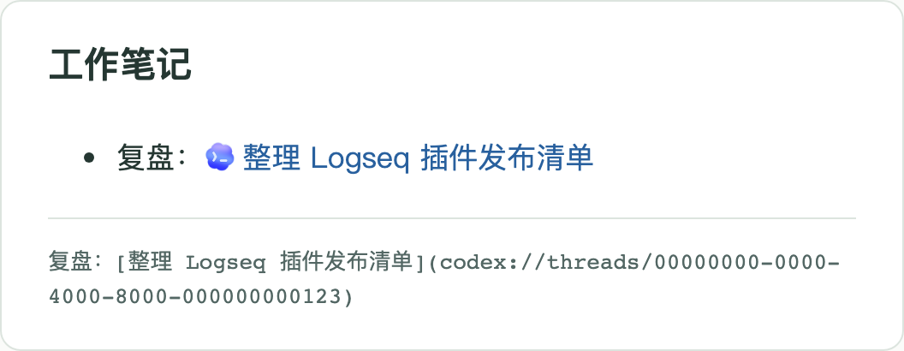

# Codex 会话链接

适用于 macOS 上的 Logseq 2.0.2 DB 桌面版和使用本地会话目录的 Codex 桌面客户端。

**Codex Chat Links** for macOS. Paste a chat link into a Logseq block to insert a clickable title and distinguish it with an inline icon. The optional local helper looks up chat titles on this Mac.

## 使用

打开目标 Codex 会话，按 **⌘⌥L** 复制深层链接。在 Logseq 里点进要编辑的块，按 **⌘V**。退出编辑后，点击会话标题即可回到对应会话。Logseq 可能会询问是否打开外部应用。

阅读时，已有和新粘贴的 Codex 会话链接都会在标题前显示蓝色 Codex 图标。图标取自本机 Codex 桌面应用，由插件在本地显示，笔记里保存的仍是标准 Markdown 链接。

同一个块可以多次粘贴，也可以一次粘贴多条仅用空白分隔的会话链接。插件保留每条链接的参数。标题使用粘贴当时已索引的名称，已有笔记里的标题可自行修改。如果本机暂时查不到名称，插件使用「Codex 会话」和短 ID 作为可点击的文本。

## 安装与标题来源

从市场安装后即可粘贴链接。要启用本机标题查询，在终端运行 `/usr/bin/python3 "$HOME/.logseq/plugins/logseq-codex-links/install.py"`。首次从 Release ZIP 安装时，也可在解压目录运行 `/usr/bin/python3 install.py` 后重新打开 Logseq。安装程序将插件放入 `~/.logseq/plugins/logseq-codex-links`，并注册用户级 macOS 启动项 `local.logseq.codex-link-titles`。

启动项在本地 Codex 目录发生变化时短暂运行，从 `~/.codex/sqlite/codex.db` 的 `local_thread_catalog` 只读获取主机 ID、会话 ID 和显示标题。私有索引位于 `~/.logseq/storages/logseq-codex-links/titles.json`，仅当前用户可读写。粘贴不需要网络，Logseq 图谱只保存粘贴到该块的 Markdown 链接。标题索引更新通常需要几秒钟。

要卸载，在 Logseq 插件页禁用此插件，在终端运行 `launchctl bootout gui/$(id -u)/local.logseq.codex-link-titles`，然后移除上述插件目录、标题索引与 `~/Library/LaunchAgents/local.logseq.codex-link-titles.plist`。已粘贴的 Markdown 链接可继续使用。
